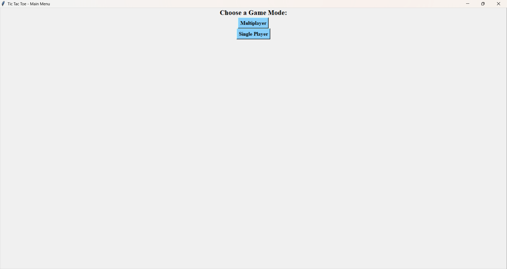
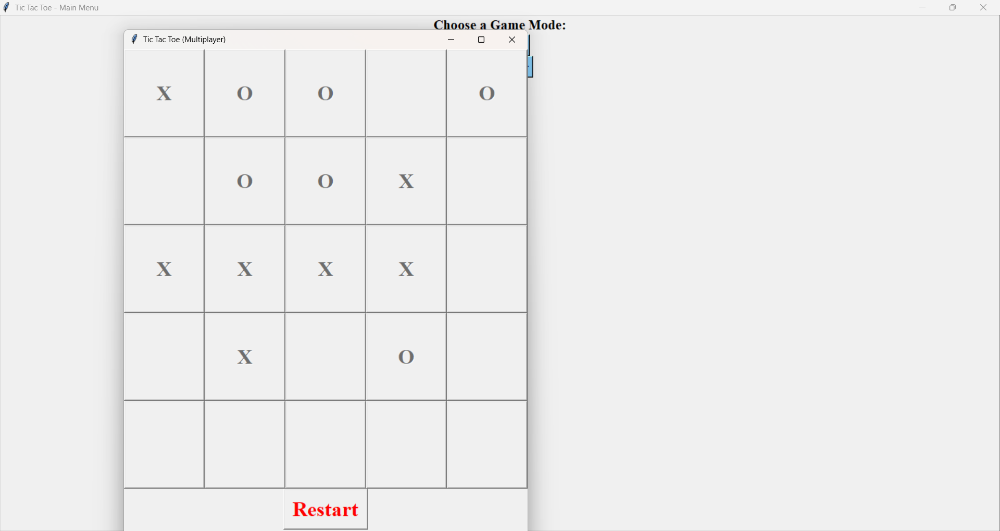
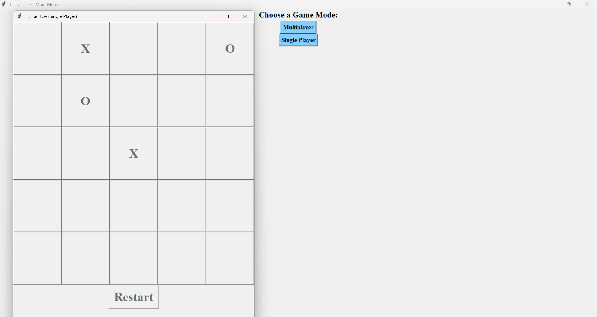

# 🎮 Tic Tac Toe 5x5 (Python & Tkinter)

A desktop Tic Tac Toe game built with Python and Tkinter. Instead of the classic 3x3 grid, this version is played on a **5x5 board**, and the first player to get **4 in a row** wins. Play against the computer or challenge a friend on the same PC.


---

## 📸 Screenshot

### Main Menu


### Multiplayer Mode


### Single Player Mode


---

## ✨ Features

- **Main menu** to choose between Single Player and Multiplayer
- **Single Player:** play as X against a computer opponent (O) that makes random moves
- **Multiplayer:** two players take turns on the same computer
- **5x5 board** with a **4-in-a-row** win condition (horizontal, vertical, or diagonal)
- **Colour-coded marks:** X in blue, O in red
- **Win and tie detection** with a result message
- **Restart button** to play again without relaunching the app

---

## 🛠️ Requirements

- Python 3.x
- Tkinter (comes pre-installed with most Python installations)

To check that Tkinter is available, run:

```bash
python -m tkinter
```

A small test window should appear.

---

## 🚀 How to Run

1. **Clone the repository**
   ```bash
   git clone https://github.com/your-username/your-repo-name.git
   ```
2. **Go into the project folder**
   ```bash
   cd your-repo-name
   ```
3. **Run the game**
   ```bash
   python tictactoe.py
   ```

> Replace `tictactoe.py` with the actual name of your Python file.

---

## 🕹️ How to Play

1. Choose **Single Player** or **Multiplayer** from the main menu.
2. Click any empty square to place your mark. **X always goes first.**
3. Get **4 marks in a row** (across, down, or diagonally) to win.
4. If the board fills up with no winner, the game ends in a **tie**.
5. Click **Restart** after a game ends to play again.

---

## 📁 Project Structure

```
├── tictactoe.py        # Main game code
├── screenshots/        # Game screenshots
│   ├── menu.png
│   ├── multiplayer.png
│   └── single-player.png
└── README.md
```

---

## 🧠 How It Works

- The board is stored as a 5x5 list of lists, and each cell is a Tkinter `Button`.
- After every move, the game scans all rows, columns, and diagonals for four consecutive matching marks.
- In single-player mode, the computer picks a random empty cell for its move.

---

## 🔮 Future Improvements

- Smarter AI that blocks and attacks instead of moving randomly
- Adjustable board size and winning length
- Score tracking across rounds
- Option to choose X or O
- Sound effects and highlighting of the winning line

---

## 👤 Author

**Your Name**
GitHub: [@your-username](https://github.com/your-username)

---

## 📄 License

This project is open source and available under the [MIT License](LICENSE).

